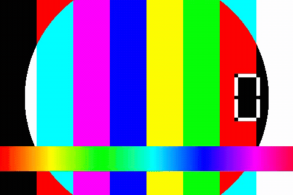
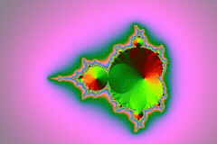

# GifDrop

A drag-and-drop desktop app that converts video files into high-quality GIFs or lossless APNGs. Built with Tauri v2, Rust, and TypeScript.

Drop a video, pick your format, hit Convert. The output lands right next to the source file — same folder, same name, different extension.

## Features

- **Drag-and-drop or click-to-browse** — drop a file onto the window or click the drop zone to open a native file picker
- **Two output formats**
  - **GIF** — 256-color optimized palette with Bayer dithering for high quality at small file sizes
  - **APNG** — pixel-perfect lossless full-color output, supports transparency
- **Defaults to source frame rate** — no manual FPS tweaking needed (override available)
- **Optional max-width scaling** — downscale large videos to keep output size reasonable
- **Live before/after preview** — source video on the left, output animation on the right
- **Progress bar** — real-time conversion progress via ffmpeg's progress protocol
- **Save-to-source behavior** — output always lands in the same folder as the input
- **"Open folder" button** — reveals the generated file in Explorer, highlighted
- **Tactile feedback** — click sounds, ripple effects, and press animations on every interaction
- **No console windows** — ffmpeg runs headless on Windows (no CMD popups)
- **Auto-locates ffmpeg** — searches PATH, `C:\ffmpeg-gpl\`, `C:\ffmpeg\`, chocolatey, winget, and Program Files

## Screenshots

### Sample GIF output (from testsrc)



### Mandelbrot zoom GIF output



## Quick start

### Option 1: Download the installer

1. Go to the [Releases](../../releases) page
2. Download `GifDrop_0.1.0_x64-setup.exe` (NSIS installer) or `GifDrop_0.1.0_x64_en-US.msi` (MSI installer)
3. Run the installer
4. Launch GifDrop from the Start Menu

### Option 2: Build from source

#### Prerequisites

- [Node.js](https://nodejs.org/) 18+ (includes npm)
- [Rust](https://www.rust-lang.org/tools/install) (stable toolchain)
- [ffmpeg](https://ffmpeg.org/download.html) + ffprobe — installed and on your PATH, or in one of the auto-detect locations:
  - `C:\ffmpeg-gpl\<build>\bin\`
  - `C:\ffmpeg\bin\`
  - `C:\ProgramData\chocolatey\bin\`
  - `C:\Program Files\ffmpeg\bin\`
  - `%LOCALAPPDATA%\Microsoft\WinGet\Packages\Gyan.FFmpeg*\ffmpeg-master-latest-win64-gpl\bin\`
- Windows 10 or 11 (x64)

#### Build steps

```powershell
git clone https://github.com/theCosmicCrafter/gifdrop.git
cd gifdrop
npm install
npm run tauri build
```

The built executable and installers will be at:

```
src-tauri\target\release\gifdrop.exe
src-tauri\target\release\bundle\msi\GifDrop_0.1.0_x64_en-US.msi
src-tauri\target\release\bundle\nsis\GifDrop_0.1.0_x64-setup.exe
```

### Option 3: Run in dev mode

```powershell
git clone https://github.com/theCosmicCrafter/gifdrop.git
cd gifdrop
npm install
npm run tauri dev
```

This launches the app with hot-reload for frontend changes.

## Walkthrough

### 1. Open the app

Launch GifDrop. You'll see a dark window with a drop zone in the center.

### 2. Load a video

Either:
- **Drag** a video file onto the drop zone, or
- **Click** the drop zone to open a native file picker

Supported input formats (anything ffmpeg can read): `.mp4`, `.mov`, `.avi`, `.mkv`, `.webm`, `.m4v`, `.wmv`, `.flv`, `.ts`, `.3gp`

### 3. Review the preview

Once loaded, you'll see:
- The **filename** and metadata (resolution, duration, FPS)
- A **source preview** (left) — the original video, playable with controls
- An **output placeholder** (right) — "Convert to see preview"

### 4. Choose your settings

- **Output format**: GIF or APNG (toggle the segmented control)
- **FPS**: Defaults to the source frame rate. Lower this to reduce file size.
- **Max width**: Set to `0` for no scaling, or a pixel value (e.g. `480`) to downscale. Useful for large source videos.

### 5. Convert

Click **Convert**. The progress bar shows real-time status:
- "Starting conversion" → "Converting" (with percentage) → "Finalizing" → "Done"

A success chime plays when conversion completes.

### 6. View the result

After conversion:
- The **output preview** (right) shows the generated GIF/APNG animating
- The **output path** is displayed
- Click **Open folder** to reveal the file in Explorer (highlighted)

The output file is saved in the same directory as the input, with the same name but a different extension (`.gif` or `.apng`). If a file with that name already exists, a number is appended (e.g. `video_1.gif`).

## Examples

The `examples/` folder contains sample inputs and outputs:

| Input | Output | Format | Notes |
|-------|--------|--------|-------|
| `sample-input.mp4` (16 KB) | `sample-output.gif` (544 KB) | GIF | FFmpeg testsrc pattern, 480x320, 15 fps |
| `mandelbrot.mp4` (219 KB) | `mandelbrot-output.gif` (461 KB) | GIF | Mandelbrot zoom, 480x320, 8 fps, 128 colors |

To reproduce these outputs:

```powershell
# GIF (high quality, 256 colors, Bayer dither)
ffmpeg -i input.mp4 -filter_complex "fps=15,split[s0][s1];[s0]palettegen=max_colors=256[p];[s1][p]paletteuse=dither=bayer" -loop 0 output.gif

# APNG (lossless)
ffmpeg -i input.mp4 -vf "fps=15" -c:v apng -pred mixed -plays 0 output.apng
```

## How it works

### Architecture

```
┌─────────────────────────────────────────┐
│  Frontend (TypeScript + HTML + CSS)     │
│  - Drag-and-drop via Tauri webview API  │
│  - File picker via tauri-plugin-dialog  │
│  - Preview via asset protocol           │
│  - Progress via Tauri events            │
├─────────────────────────────────────────┤
│  Backend (Rust)                         │
│  - probe_video: ffprobe metadata read   │
│  - convert_video: ffmpeg conversion     │
│  - Progress streaming via stdout        │
│  - Headless process spawning (Windows)  │
├─────────────────────────────────────────┤
│  FFmpeg / FFprobe (external)            │
│  - Auto-located on PATH or common dirs  │
└─────────────────────────────────────────┘
```

### GIF quality

GIFs use a two-pass palette approach:
1. **Palette generation** (`palettegen`): analyzes the video and generates an optimal 256-color palette
2. **Palette application** (`paletteuse`): maps each frame to the palette using Bayer dithering for smooth gradients

This produces significantly higher quality than single-pass GIF encoding.

### APNG quality

APNGs use the `apng` encoder with `mixed` prediction for better compression while remaining pixel-perfect lossless. The output preserves the full color range of the source.

### Headless ffmpeg on Windows

On Windows, spawning child processes normally creates visible console windows. GifDrop applies the `CREATE_NO_WINDOW` (0x08000000) creation flag to every ffmpeg/ffprobe spawn, so no CMD windows flash on screen. All stdout/stderr is captured in-process for progress tracking and error reporting.

## Tech stack

| Layer | Technology |
|-------|-----------|
| Desktop framework | [Tauri v2](https://v2.tauri.app/) |
| Backend | Rust + [tokio](https://tokio.rs/) (async) |
| Frontend | TypeScript + Vite (vanilla, no framework) |
| Video processing | [FFmpeg](https://ffmpeg.org/) + ffprobe |
| File dialog | [tauri-plugin-dialog](https://v2.tauri.app/plugin/dialog/) |
| File reveal | [tauri-plugin-opener](https://v2.tauri.app/plugin/opener/) |
| Binary location | [which](https://crates.io/crates/which) crate |

## Configuration

### Window defaults

Configured in `src-tauri/tauri.conf.json`:
- Default size: 880 x 920 px
- Minimum size: 480 x 520 px
- Resizable: yes

### Asset protocol

The asset protocol is enabled with a broad scope (`**`) to allow previewing any local file. This is necessary because the user picks arbitrary files from anywhere on their system.

## Development

### Project structure

```
gifdrop/
├── src/                    # Frontend
│   ├── main.ts            # App logic (drag-drop, conversion, feedback)
│   ├── styles.css         # Styling
│   └── assets/            # Static assets
├── src-tauri/              # Backend
│   ├── src/
│   │   ├── lib.rs         # Core logic (probe, convert, ffmpeg)
│   │   └── main.rs        # Entry point
│   ├── Cargo.toml         # Rust dependencies
│   ├── tauri.conf.json    # Tauri config
│   └── capabilities/      # Permission scopes
├── examples/              # Sample inputs and outputs
├── index.html             # App HTML
├── package.json           # Node dependencies
├── tsconfig.json          # TypeScript config
└── vite.config.ts         # Vite config
```

### Running tests

```powershell
cd src-tauri
cargo test
```

The test generates a synthetic video with ffmpeg's `testsrc` filter, probes it with ffprobe, and verifies the metadata (resolution, FPS, duration).

### Building for release

```powershell
npm run tauri build
```

Produces:
- `gifdrop.exe` — standalone executable
- `GifDrop_0.1.0_x64-setup.exe` — NSIS installer
- `GifDrop_0.1.0_x64_en-US.msi` — MSI installer

## Troubleshooting

### "ffmpeg not found"

GifDrop searches these locations in order:
1. System PATH
2. `C:\ffmpeg-gpl\<any subfolder>\bin\`
3. `C:\ffmpeg\bin\`
4. `C:\ProgramData\chocolatey\bin\`
5. `C:\Program Files\ffmpeg\bin\`
6. `%LOCALAPPDATA%\Microsoft\WinGet\Packages\Gyan.FFmpeg*\`

Install ffmpeg via any of these methods:
- **winget**: `winget install Gyan.FFmpeg`
- **chocolatey**: `choco install ffmpeg`
- **Manual**: Download from [ffmpeg.org](https://ffmpeg.org/download.html) and add to PATH

### "Could not read video info"

The file may be corrupted or in an unsupported format. Try playing it in VLC — if VLC can't read it, ffmpeg can't either.

### Conversion is slow

- Lower the FPS (e.g. from 30 to 15)
- Set a max-width (e.g. 480) to reduce resolution
- GIF is slower than APNG due to the two-pass palette generation

### Output file is huge

- Use GIF instead of APNG (APNG is lossless and can be very large)
- Lower the FPS
- Set a max-width
- Trim the source video before converting

## License

MIT — see [LICENSE](LICENSE)

## Contributing

See [CONTRIBUTING.md](CONTRIBUTING.md)

## Acknowledgments

- [Tauri](https://tauri.app/) — the framework that makes this possible
- [FFmpeg](https://ffmpeg.org/) — the swiss army knife of video processing
- The Rust and TypeScript communities
